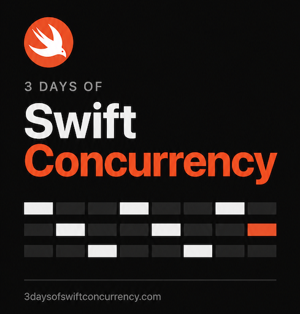
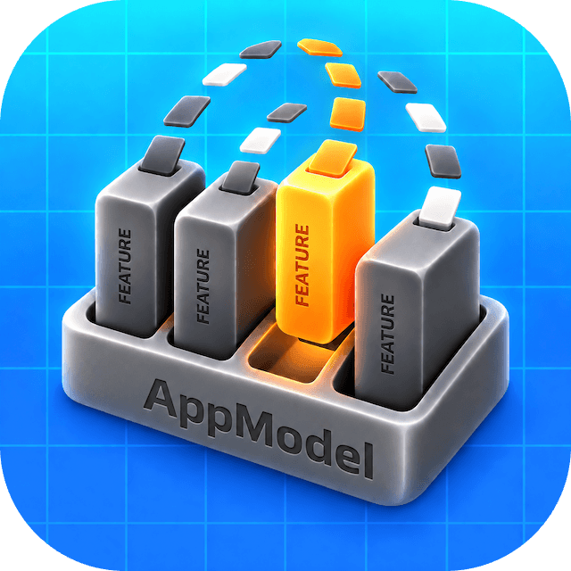

<a href="https://www.kickstarter.com"></a>

<p>
  <a href="https://www.3daysofswiftconcurrency.com/"></a>
  <a href="https://github.com/3DaysOfSwift/CFA-AI-Toolkit-for-iOS"></a>
</p>

# Kickstarter iOS: an AI-assisted CFA migration

This repository is an independent educational migration of [Kickstarter's open-source iOS app](https://github.com/kickstarter/ios-oss), published by 3 Days of Swift Concurrency. It is not an official Kickstarter release. This `main` branch preserves the upstream starting point; the migrated app is on **`migration/cfa-swift-concurrency`**.

[Browse the migrated branch](https://github.com/3DaysOfSwift/Legacy-GCD-Migration-iOS-App-Kickstarter/tree/migration/cfa-swift-concurrency) · [Download the migrated branch as a ZIP](https://github.com/3DaysOfSwift/Legacy-GCD-Migration-iOS-App-Kickstarter/archive/refs/heads/migration/cfa-swift-concurrency.zip) · [Read the migration and verification ledger](https://github.com/3DaysOfSwift/Legacy-GCD-Migration-iOS-App-Kickstarter/blob/migration/cfa-swift-concurrency/MIGRATION_LEDGER.md)

## Migration report

| Phase | Work and status |
| --- | --- |
| 1. Autonomous migration | AI-assisted migration to CFA and Swift Concurrency, with human direction and verification; implementation handover recorded. |
| 2. Structure and cleanup | Core app code moved into the CFA folders; redundant migrated files and application-library packaging removed. |
| 3. ReactiveSwift removal | Reactive workflows and state replaced with async operations, Observation and direct presentation callbacks; ReactiveSwift and ReactiveExtensions removed from app and test targets. |
| 4. Manual testing and refinement | Simulator build, regression tests and representative demo browsing checked; further validation remains open. |

| Recorded milestone | Bangkok time | Elapsed from first record |
| --- | --- | --- |
| Earliest recorded preparation | 26 Oct 2026, 14:18 | Starting point |
| CFA implementation handover | 3 Nov 2026, 21:44 | About 8 days 7 hours 26 minutes |
| ReactiveSwift removal checkpoint | 7 Nov 2026, 03:27 | About 11 days 13 hours 9 minutes |

These are **elapsed calendar times**, including interruptions, human input and review—not continuous AI work. Phases overlapped; exact start and finish times for each phase were not recorded. Screenshots identify GPT-6 Astra High for portions of the work, but not every model used.

**Verification:** 2,929 selected tests passed at handover; later separate, overlapping runs passed 1,944 non-snapshot model tests, 183 non-snapshot presentation tests and 39 signed keychain tests. Reference snapshot comparisons, physical-device review and live account/payment operations remain unverified. See the [migration ledger](https://github.com/3DaysOfSwift/Legacy-GCD-Migration-iOS-App-Kickstarter/blob/migration/cfa-swift-concurrency/MIGRATION_LEDGER.md) for evidence and limitations.

To clone the migrated version directly:

```sh
git clone --branch migration/cfa-swift-concurrency --single-branch https://github.com/3DaysOfSwift/Legacy-GCD-Migration-iOS-App-Kickstarter.git
cd Legacy-GCD-Migration-iOS-App-Kickstarter
```

Follow the [migrated branch's README](https://github.com/3DaysOfSwift/Legacy-GCD-Migration-iOS-App-Kickstarter/blob/migration/cfa-swift-concurrency/README.md) for Xcode setup and its fictional-data demo. The project still uses Swift packages, which Xcode must resolve.

## Architecture and migration outcome

The **starting app** uses UIKit and local Swift packages, including `Library` and `Kickstarter-Framework`, with ReactiveSwift signals connecting many view-model inputs, outputs and asynchronous workflows.

The **migrated app** retains the UIKit screens and moves core app code into the Xcode application target, organised as:

- **`1 - View`** — screens, controllers, view models and shared UI.
- **`2 - AppModel`** — app composition, features, storage and service adapters.
- **`3 - App Resources`** — configuration, localization and other app resources.
- **`4 - Swift Extensions`** — shared application extensions.

Cooperative Feature Architecture (CFA) gives features ownership of state and workflows, with view models and controllers handling presentation. The migrated code uses Swift Concurrency and Observation; selected services, generated APIs, design components and third-party SDKs remain in Swift packages. ReactiveSwift and ReactiveExtensions have been removed from the migrated app and test targets.

The simulator app built and a limited fictional-data discovery, project and search smoke test passed. This is not a production certification or a claim of race freedom. See the [migrated README](https://github.com/3DaysOfSwift/Legacy-GCD-Migration-iOS-App-Kickstarter/blob/migration/cfa-swift-concurrency/README.md) for setup and scope.

## Original upstream README

The following material is retained from the original Kickstarter repository for attribution and historical context. Its first-person references describe Kickstarter's upstream project, and its setup instructions apply to the baseline rather than the migrated branch.

---

[](https://circleci.com/gh/kickstarter/ios-oss)

Welcome to Kickstarter’s open source iOS app! Come on in, take your shoes off,
stay a while—explore how Kickstarter’s native squad has built and continues to
build the app.

We’ve also open sourced our [Android app](https://github.com/kickstarter/android-oss),
and read more about our journey to open source [here](https://kickstarter.engineering/open-sourcing-our-android-and-ios-apps-6891be909fcd).

## Getting Started

1. Install Xcode. We currently support Xcode 26.6.
2. Clone this repository.

&#42; To provide a mock version that serves up hard-coded data immediately, set `KsApi.Secrets.isOSS` = `true`.

## Some fun things to explore

If you’re just looking for a quick glance at a few things we’re particularly
proud of, look no further:

* The snapshots directory in each feature folder of `Kickstarter-Framework-iOS` together holds nearly 600 screenshots of various screens in every language,
device and edge-case state that we like to make sure stays true. For example,
a backer viewing a project in Japanese
[here](https://github.com/kickstarter/ios-oss/blob/main/Kickstarter-iOS/Features/ProjectPage/Controller/__Snapshots__/ProjectPageViewControllerTests/testLoggedIn_Backer_LiveProject_NonUS_ProjectCurrency_US_ProjectCountry_NonUS_UserChosenCurrency_NotOmittingCurrencyCode_Success.lang_ja_device_pad.png)
, or a creator looking at their dashboard in German and on an iPad
[here](https://github.com/kickstarter/ios-oss/blob/main/Kickstarter-iOS/Features/Dashboard/Controller/__Snapshots__/DashboardViewControllerTests/testView.lang_de_device_pad.png).

* [We use view models](https://www.youtube.com/watch?v=EpTlqx6NjYo) as
a lightweight way to isolate side effects and embrace a functional core. We
write [these](https://github.com/kickstarter/ios-oss/tree/main/Library/ViewModels)
as a pure mapping of input signals to output signals, and [test](https://github.com/kickstarter/ios-oss/tree/main/Library/ViewModels)
them heavily, including tests for localization, accessibility and event
tracking.

## Testing the project

- Run all tests from the command line by running `make test-all`.
- Run an individual scheme's tests by selecting that scheme in Xcode and hitting CMD+U.

## Documentation

While we’re at it, why not share our docs? Check out the
[native docs](https://github.com/kickstarter/native-docs) we have written so far
for more documentation.

## Dependencies

We make heavy use of the following projects, and so it can be helpful to be
familiar with them:

### 1st party

* [](https://circleci.com/gh/kickstarter/Kickstarter-Prelude)
[Prelude](https://github.com/kickstarter/Kickstarter-Prelude): Foundation of
types and functions we feel are missing from the Swift standard library. 

* [](https://circleci.com/gh/kickstarter/Kickstarter-ReactiveExtensions)
[ReactiveExtensions](https://github.com/kickstarter/Kickstarter-ReactiveExtensions):
A collection of operators we like to add to ReactiveCocoa. Built on top of ReactiveSwift.

### 3rd party

* [AlamofireImage](https://github.com/Alamofire/AlamofireImage)
* [SnapshotTesting](https://github.com/pointfreeco/swift-snapshot-testing)
* [Apollo](https://github.com/apollographql/apollo-ios)
* [Stripe](https://github.com/stripe/stripe-ios)
* [KingFisher](https://github.com/onevcat/Kingfisher)
* [SwiftSoup](https://github.com/scinfu/SwiftSoup)
* [Facebook](https://github.com/facebook/facebook-ios-sdk)
* [Firebase](https://github.com/firebase/firebase-ios-sdk)
* [Appboy](https://github.com/Appboy/Appboy-segment-ios)
* [PerimeterX](https://github.com/PerimeterX/px-iOS-Framework)

Notices for 3rd party libraries in this repository are contained in
`NOTICE.md`.

## Contributing

We intend for this project to be an educational resource: we are excited to
share our wins, mistakes, and methodology of iOS development as we work
in the open. Our primary focus is to continue improving the app for our users in
line with our roadmap.

The best way to submit feedback and report bugs is to open a GitHub issue.
Please be sure to include your operating system, device, version number, and
steps to reproduce reported bugs. Keep in mind that all participants will be
expected to follow our code of conduct.

## Code of Conduct

We aim to share our knowledge and findings as we work daily to improve our
product, for our community, in a safe and open space. We work as we live, as
kind and considerate human beings who learn and grow from giving and receiving
positive, constructive feedback. We reserve the right to delete or ban any
behavior violating this base foundation of respect.

## Find this interesting?

We do too, and we’re [hiring](https://www.kickstarter.com/jobs)!

## License

```
Copyright 2021 Kickstarter, PBC.

Licensed under the Apache License, Version 2.0 (the "License");
you may not use this file except in compliance with the License.
You may obtain a copy of the License at

   http://www.apache.org/licenses/LICENSE-2.0

Unless required by applicable law or agreed to in writing, software
distributed under the License is distributed on an "AS IS" BASIS,
WITHOUT WARRANTIES OR CONDITIONS OF ANY KIND, either express or implied.
See the License for the specific language governing permissions and
limitations under the License.
```
